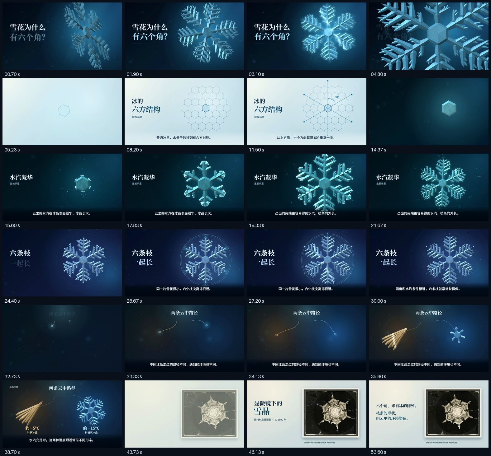

# 雪花为什么有六个角

54 秒原创中文科普短片。从六方冰晶的结构出发，看水汽沉积怎样让枝条长出来，以及温度和环境怎样影响针晶与板状雪花。

[在线观看](https://yangwei251003.github.io/snowflake-hexagon-film/) · [成片 MP4](media/snowflake.mp4) · [独立动作音效 WAV](media/action-sfx.wav) · [时间码](docs/timecodes.md)

## 运行和再编辑

    python -m http.server 8000 --bind 127.0.0.1

打开 http://127.0.0.1:8000/ 播放成片。打开 /source/index.html 查看 WebGL 画面源，浏览器控制台执行 window.render(12) 可查看第 12 秒。source/timeline.json 保存分镜、字幕和动作时间。source/motion.js 驱动画面，source/crystal.js 生成冰晶几何。

成片为 1920×1080、30 fps、1620 帧。独立音效是 48 kHz 双声道 PCM WAV，与成片同为 54 秒，可直接用于二次混音。

source/mix_audio.py 保留动作音效的混音配方，重合成需 NumPy、FFmpeg、同散列的原版音效引擎及 CC0 快门样本：

    python source/mix_audio.py --engine /path/to/film.py --shutter /path/to/shutter.mp3

重合成文件写入 qa/。已渲染动作音效可直接从 media/ 使用。

## 资料与授权

冰晶生长参考 [Libbrecht, The physics of snow crystals](https://authors.library.caltech.edu/records/70qmc-09861)。影片中的晶格、温度路径和流线均为教学示意。

原创源码和作者文档采用 [MIT](LICENSE)。随附 Three.js 采用 [MIT](source/vendor/THREE-LICENSE.txt)，Noto 字体采用 [OFL](source/assets/OFL-NotoSansSC.txt)。[Smithsonian 显微照片](docs/photo-provenance.json)与 [Fission9 快门](https://freesound.org/people/Fission9/sounds/693869/)均采用 CC0。影片以原创动画为主，引用素材按各自许可证分发。
